# Introduction à Godot - V1.0

## ATTENTION À LIRE AVANT DE COMMENCER

Ce workshop a été conçu pour être réalisé sous **Linux**. Il est basé sur le tutoriel présent dans la [documentation officielle de Godot](https://docs.godotengine.org/en/stable/about/introduction.html) pour être adapté à EPITECH Paris. Certaines images proviennent de la documentation officielle.

### Installer le SDK .NET

Commencez par installer le SDK .NET avec les commandes suivantes :

```bash
sudo apt-get update
sudo apt-get install -y dotnet-sdk-10.0
```

### Installer Godot pour .NET

Téléchargez la version **Godot .NET** depuis le site officiel :

https://godotengine.org/download/linux/

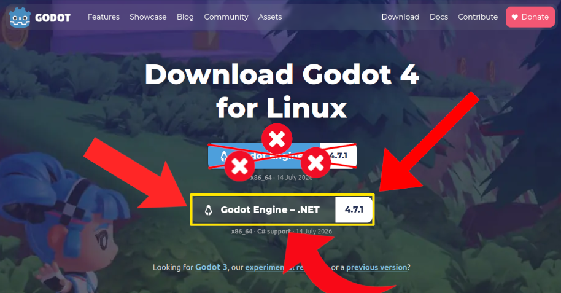

### Si la grille d'affichage est cassée

Selon votre matériel graphique, il est possible que la grille de l'éditeur s'affiche mal.

Dans Godot, ouvrez :

* Project → Project Settings → Rendering → Renderer

Puis changez **Rendering Method** de **Forward Plus** vers **GL Compatibility**.

---

# Introduction

Dans ce workshop, nous allons découvrir les concepts essentiels de Godot :

* Les Scènes
* Les Nodes
* Les Signaux
* Les scripting en C# <sub>Nous n'allons pas faire de GDScript, désolé :)</sub>

La documentation officielle est une excellente ressource. N'hésitez pas à la consulter pendant le workshop :

https://docs.godotengine.org/en/stable/tutorials/best_practices/index.html

Vous pouvez également consulter la **documentation hors-ligne directement dans l'éditeur** grâce au bouton **`Search Help`** dans la vue **Script**

Notre objectif sera de créer un personnage capable de se déplacer dans une scène 2D.

---

# Créer le player

Commencez par créer un nouveau node de type **Area2D**.

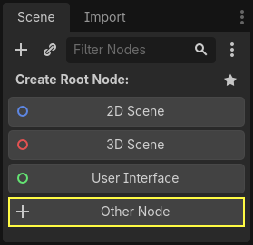
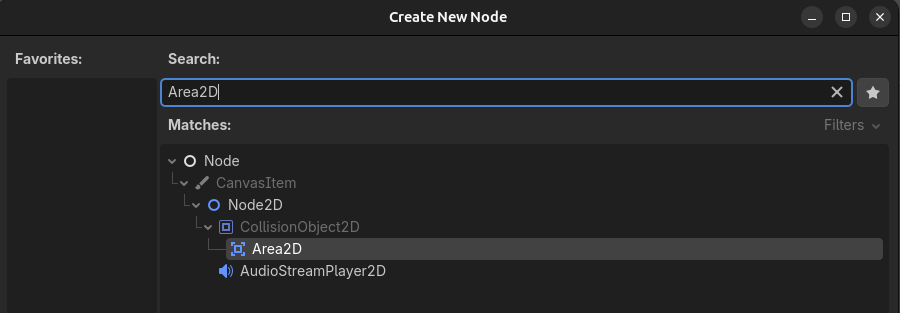

Renommez-le **Player** (`F2`).

Pour éviter de redimensionner accidentellement les objets enfants, verrouillez-les dès maintenant.

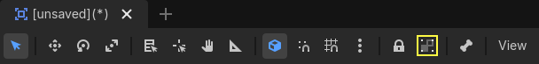

Sélectionnez le node **Player**, puis utilisez **Ctrl + A** pour ajouter un Node enfant de type **Sprite2D**.

Dans la propriété **Texture** du Sprite, faites glisser le fichier **icon.svg**, fourni par défaut dans les nouveaux projets Godot.

Ajoutez ensuite un deuxième enfant avec **Ctrl + A** : un **CollisionShape2D**.

Dans l'inspecteur, choisissez une **RectangleShape2D**, puis redimensionnez-la afin qu'elle recouvre correctement le sprite.

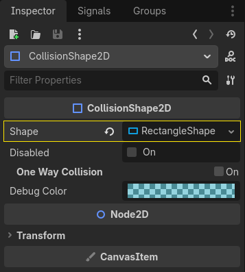
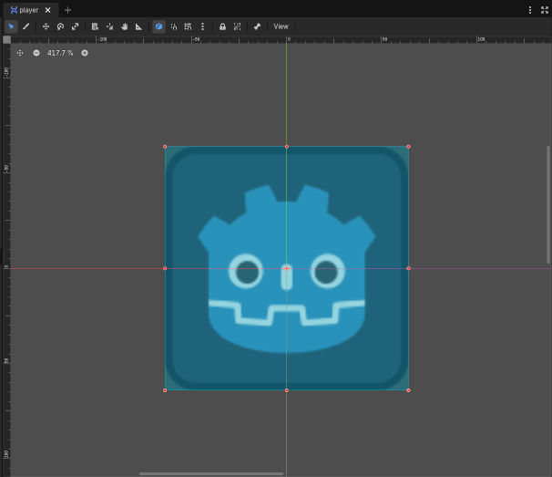

Une fois terminé, sauvegardez la scène sous le nom `player.tscn`.

---

Nous venons de créer des **Nodes** dans l'arborescence d'une **Scène**.
Les Nodes sont les briques fondamentales de Godot, elles permettent de construire des objects complexes en respectant une hiérarchie.

> Remarquez que les Nodes que nous avons crées finissent par `2D`, car nous sommes dans une scène en 2D. Il existe les mêmes types de node pour la **3D**

---

## Le Code

Ajoutez maintenant un script **C#** au node **Player**.

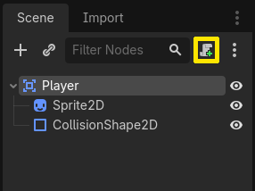

Comme nous utilisons C#, pensez à **compiler régulièrement** votre projet. Le bouton de compilation se trouve dans la barre d'outils.

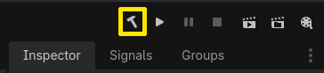

Ajoutez le code suivant :

```cs
using Godot;

public partial class Player : Area2D
{
    [Export]
    public int Speed { get; set; } = 400; // How fast the player will move (pixels/sec).

    public Vector2 ScreenSize; // Size of the game window.
}
```

Prenez quelques minutes pour comprendre ce que fait ce code :

* l'attribut `[Export]` permet de rendre une variable modifiable directement depuis l'inspecteur de Godot ;
* `Speed` représente la vitesse de déplacement du joueur ;
* `ScreenSize` contiendra la taille de la fenêtre de jeu.

Avant de continuer, il est également important de comprendre le rôle des méthodes `_Ready()` et `_Process()`.

Ajoutez ensuite la méthode suivante :

```cs
public override void _Ready()
{
    ScreenSize = GetViewportRect().Size;
}
```

Cette méthode est appelée une seule fois lorsque le node est prêt. Ici, on récupère simplement la taille de la fenêtre afin de pouvoir empêcher le joueur d'en sortir plus tard.

---

## Configurer les contrôles

Ouvrez :

**Project → Project Settings → Input Map**

Ajoutez une nouvelle action appelée **move_right**, puis cliquez sur **Add**.

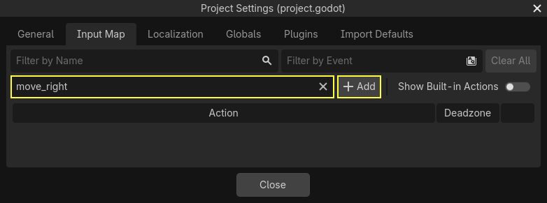

Pour associer une touche à cette action, cliquez sur le **+** situé à droite.

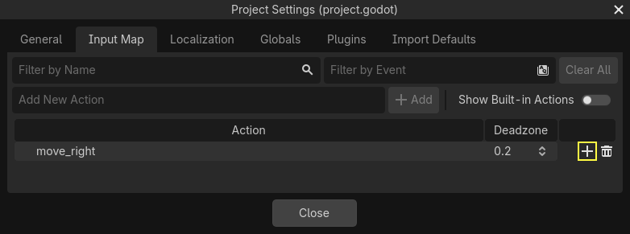

La détection du clavier étant active, appuyez simplement sur la flèche droite, puis validez avec **OK**.

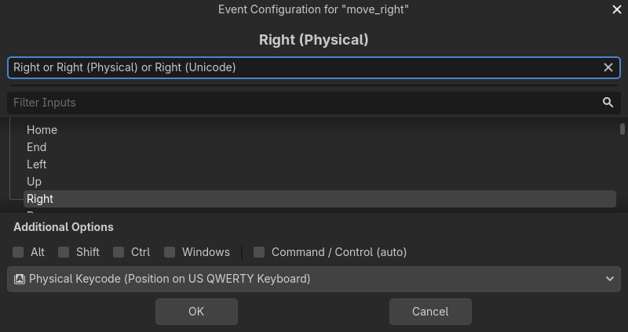

Répétez exactement la même opération pour les actions :

* `move_left`
* `move_up`
* `move_down`

À la fin, votre configuration devrait ressembler à ceci :

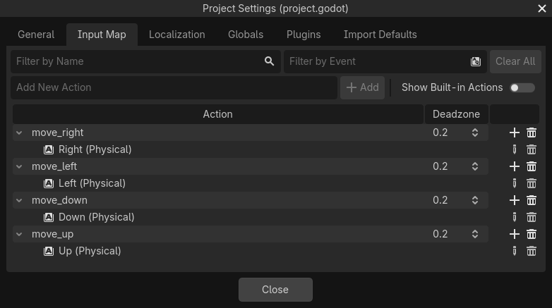

Vous pouvez maintenant fermer cette fenêtre.

---

Nous allons maintenant écrire le code qui détecte les entrées clavier.

```cs
public override void _Process(double delta)
{
    var velocity = Vector2.Zero; // Le vecteur de mouvement du joueur

    if (Input.IsActionPressed("move_right"))
    {
        velocity.X += 1;
    }

    if (Input.IsActionPressed("move_left"))
    {
        velocity.X -= 1;
    }

    if (Input.IsActionPressed("move_down"))
    {
        velocity.Y += 1;
    }

    if (Input.IsActionPressed("move_up"))
    {
        velocity.Y -= 1;
    }
}
```

Au début de chaque frame, `velocity` vaut `(0, 0)`, ce qui signifie que le joueur est immobile.

Chaque touche pressée modifie ce vecteur :

* aller à droite augmente `X` ;
* aller à gauche le diminue ;
* monter diminue `Y` ;
* descendre l'augmente.

À ce stade, nous calculons uniquement une direction de déplacement. Le personnage ne bouge pas encore.

---

Ajoutez maintenant le déplacement du joueur à la fin de la fonction `_Process()` :

```cs
Position += velocity * Speed * (float)delta;
Position = new Vector2(
    x: Mathf.Clamp(Position.X, 0, ScreenSize.X),
    y: Mathf.Clamp(Position.Y, 0, ScreenSize.Y)
);
```

La première ligne met à jour la position du joueur en fonction :

* de la direction (`velocity`) ;
* de sa vitesse (`Speed`) ;
* du temps écoulé depuis la frame précédente (`delta`).

> **Qu'est ce que fait la fonction `Mathf.Clamp()` ?**

Comme après chaque modification du code C#, pensez à **compiler le projet**

On peut maintenant lancer la scène avec le bouton `Play` en haut à droite de l'éditeur :

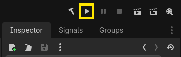

On peut déplacer le joueur dans l'écran avec les touches de direction !

---

## Préparer les collisions

Comme nous allons bientôt rajouter des ennemis dans notre jeu, il faut préparer notre joueur à pouvoir entrer en collision avec.

Pour cela, on va utiliser un outil très important de Godot : **les Signaux**

Les signaux de Godot sont l'équivalent du **[design pattern de l'observer](https://gameprogrammingpatterns.com/observer.html)** en programmation.

Ajoutez ce morceau de code dans `Player.cs`, après `public partial class Player : Area2D`

```cs
[Signal]
public delegate void HitEventHandler();
```

En C# sur Godot, un signal se déclare avec `[Signal]`, ici nous déclarons un signal custom que nous allons appeler `Hit`. Il va être émit par notre joueur lorsqu'il va entrer en collision avec un ennemi.

Nous allons utiliser `Area2D` pour détecter la collision.

Séléctionnez le `Player` à droite dans l'arborescence puis allez dans l'onglet `Signals` à droite avec l'inspecteur
<small>(Vous pouvez voir que le nouveau signal `Hit()` apparaît bien dans notre script)</small>

Nos ennemis vont être composés de Nodes `RigidBody2D`, nous allons donc avoir besoin du signal `body_entered(body: Node2D)`, il sera émit quand un `RigidBody` entrera en collision avec notre joueur.

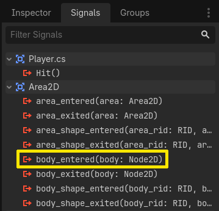

Doublez-cliquez sur le signal ou ouvrez la fenêtre de connection des signaux avec le bouton `Connect` en bas à droite.

Comme nous faison du C#, il faut respecter la `PascalCase`, changez le nom par défaut de la `Receiver Method` en `OnBodyEntered`.

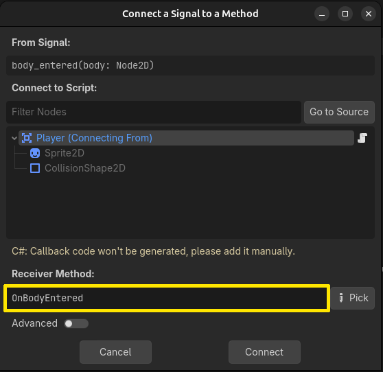

Par défaut, Godot ne va pas ajouter cette méthode dans notre script C#, il faut l'ajouter à la main. Copiez cette fonction dans `Player.cs`

```cs
private void OnBodyEntered(Node2D body)
{
    Hide(); // On fait disparaître le joueur quand il se fait toucher, puis on emmet le signal Hit.
    EmitSignal(SignalName.Hit);
    // On ne peut pas changer des propriétés physiques dans un callback de physique,
    // donc on utilise .SetDeferred()
    GetNode<CollisionShape2D>("CollisionShape2D").SetDeferred(CollisionShape2D.PropertyName.Disabled, true);
}
```

Le signal va être émit à chaque collision avec le joueur, il faut donc désactiver la collision du joueur pour éviter de trigger le `Hit` plusieurs fois.

> Désactiver la collision d'une area peut causer des erreurs si elle survient pendant le calcul des collisions du moteur, on utilise `.SetDeferred()` pour dire au moteur de désactiver la collision dès qu'il peut sans cause de problèmes.

Enfin, il ne nous manque plus qu'à reset l'état du joueur au début de chaque partie.

```cs
public void Start(Vector2 position)
{
    Position = position;
    Show();
    GetNode<CollisionShape2D>("CollisionShape2D").Disabled = false;
}
```

---

# Ajouter les ennemis

Pour notre ennemi, nous allons créer une **nouvelle Scène**
Allez dans **Scene → New Scene**, puis ajoutez les Nodes suivants :

- Rigibody2D (rennomez-le en `Mob`)
    - Sprite2D
    - CollisionShape2D
    - VisibleOnScreenNotifier2D

Comme pour le Player, n'oubliez pas de grouper le Node parent en le sélectionnant puis avec `Ctrl + G` ou bien le bouton suivant dans l'éditeur :


Vous pouvez ajouter une image de vore choix au node `Sprite2D` que vous avez créé et redimensionner les zones de collisions associées.

Changez la `Gravity Scale` dans l'inspecteur du `Mob` à `0` pour éviter qu'il ne tombe dans le vide.

Puis dans la section `CollisionObject2D`, développez le groupe `Collision` et décochez le `1` dans la propriété `Mask` afin que les mobs ne rentrent pas en collision entre eux.

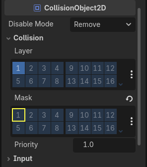

Ajoutez un script `Mob.cs` au Mob que nous venons de créer.

```cs
using Godot;

public partial class Mob : RigidBody2D
{
    // Pensez à re-build le projet.
}
```

Nous allons également ajouter une fonction qui va "free" l'ennemi lorsqu'il sortira de l'écran. Pour cela, on utilise le Signal `screen_exited()` du Node `VisibleOnScreenNotifier2D`

```cs
private void OnVisibleOnScreenNotifier2DScreenExited()
{
    QueueFree();
}
```

La fonction `QueueFree()` supprime et free un node à la fin de la frame où elle est appellée.

# La scène principale

Nous allons maintenant créer la scène principale

Commencez par ajouter un `Node` vide appelé `Main` (On utilise un Node et pas un Node2D car il va servir de container à la logique du jeu, il n'a pas besoin de fonctionalités 2D)

Cliquez sur le bouton `Instance` et séléctionnez `player.tscn`

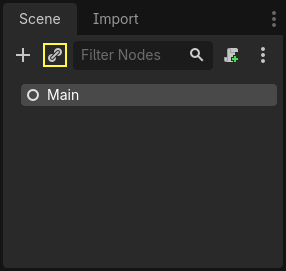

Ajoutez les Nodes suivants en enfant de votre node `Main`

- Un `Timer` nommé `MobTimer` - pour controller la fréquence de spawn des mobs
- Un `Timer` nommé `ScoreTimer` - qui va incrémenter chaque seconde le score du joueur
- Un `Timer` nommé `StartTimer` - qui va ajouter un délai avant de démarrer la partie
- Un `Marker2D` nommé `StartPosition` - qui va indiquer la position de départ du joueur

Changez le `Wait Time` de chaque timer comme suivant (valeurs en secondes) :

- `MobTimer`: **0.5**
- `ScoreTimer`: **1**
- `StartTimer`: **2**

Cochez la case `One Shot` de `StartTimer` à **On** et changez la position de `StartPosition` à **(600, 300)**.

## Spawn des mobs

Le Node principal (`Main`) va faire spawn des mobds aléatoirement et les faire se déplacer sur la carte.

Ajoutez un node `Path2D` au node `Main` et renommez-le en `MobPath`. Une fois fait, des boutons en plus vont apparaître en haut de l'éditeur.

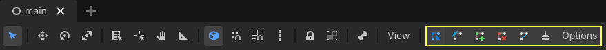

Sélectionnez le bouton `Add Point` et ajoutez des points dans les coins de la surface.

Sélectionnez les options `Use Grid Snap` et `Use Smart Snap` pour pouvoir correctement placer les points

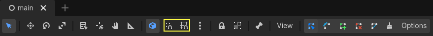

> Placez bien les points dans les coins dans le sens **horaire** sinon les ennemis spawneront dans le mauvais sens.

Après avoir placé les 4 points, cliquez sur le bouton `Close Curve` (5ème position des boutons de Path) pour fermer la boucle. Ne placez pas de 5ème point sur la position du premier.

Maintenant que nous avons défini le chemin, ajoutez un node `PathFollow2D` en enfant de `MobPath` et renommez-le `MobSpawnLocation`. Ce node va automatiquement tourner et suivre le chemin tracé par `MobPath`.

Votre scène devrait maintenant ressembler à ça :

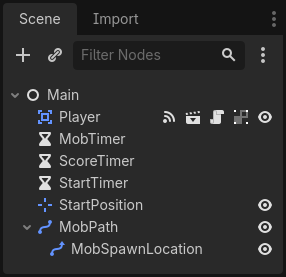

## Le script de jeu

Pour commencer nous allons vouloir récupérer une référence de la scène que nous voulons instancier plusieurs fois.

Ajoutez un script à `Main`. Nous allons utiliser un `[Export] PackedScene` afin de choisir la scène que nous voulons instancier directement dans l'éditeur.

Voilà à quoi devrait ressembler votre script :

```cs
using Godot;

public partial class Main : Node
{
    // N'oubliez pas de re-compiler le projet

    [Export]
    public PackedScene MobScene { get; set; }

    private int _score;
}
```

Dans l'inspecteur de `Main`, faites glisser la scène `mob.tscn` vue avant dans la section `Mob Scene`. Vous pouvez aussi utiliser le menu déroulant dans l'inspecteur et séléctionner la scène à cet endroit.

## En Autonomie :

Accédez aux **Signaux** du `Player` dans votre scène et **connectez** une nouvelle fonction au signal `Hit` que nous avons créé précedement.
Cette fonction va s'appeller `GameOver` et va gérer la fin du jeu.

Le processus va se dérouler ainsi :

`Player` émet le signal `Hit` → La fonction `GameOver` de `Main` catch le signal et **réinitialise les timers**

> `GetNode<???>("???").???();`

Rajoutez maintenant une fonction **`NewGame`** à votre script dans `Main` qui va :

- Réinitialiser le `_score` à **0**
- Récupérer le node `Player` dans une `var player`
- Récupérer la position de départ `StartPosition` dans une `var startPosition`
- Appeller la fonction `Start` du joueur - <small>*(cette fonction prendre quelque chose en paramètre :) )*</small>
- Démarrer le timer `StartTimer`

Nous allons maintenant connecter les signaux `timeout()` de chaque timer que nous avons créé
au script principal (vous devriez avoir compris la manipulation maintenant).

> `OnMobTimerTimeout()`  
> `OnScoreTimerTimeout()`  
> `OnStartTimerTimeout()`

Pensez à définir les fonctions en PascalCase dans la fenêtre de connection des signaux de l'éditeur.

La fonction `OnScoreTimerTimeout()` va simplement incrémenter le score
La fonction `OnStartTimerTimeout()` va démarrer les timers `MobTimer` et `ScoreTimer`

C'est dans la fonction `OnMobTimerTimeout()` que nous allons :

- Créer une nouvelle instance de `Mob`
- Trouver un endroit aléatoire sur le `Path2D`
- Mettre le mob en mouvement

Nous allons prendre une valeur aléatoire entre `150.0` et `250.0` comme vitesse du mob.

> `GD.Randf()`

> `GD.RandRange()`

Utilisez le code suivant comme base pour votre fonction :

```cs
private void OnMobTimerTimeout()
{
    // 1 - Instancier un nouveau Mob "mob"
    // TIP : Comment instancier notre Mob en utilisant une méthode d'une PackedScene ?
    // Mob mob =

    // 2 - Trouver une position aléatoire sur le Path2D
    // TIP : On récupère d'abord le node PathFollow2D dans une "var mobSpawnLocation"
    // var mobSpawnLocation =
    // TIP : Mais à quoi correspond la propriété "Progress Ratio" d'un PathFollow2D ?
    // mobSpawnLocation.ProgressRatio =

    // 3 - Changer l'orirentation du mob pour qu'il soit perpendiculaire à la direction du path
    // TIP : Dans Godot, on utilise le radiant pour les angles (man Mathf.Pi)
    // float direction =

    // 4 - Assigner la position du mob à la position aléatoirement choisie

    // 5 - On ajoute un peu d'aléatoire à la direction puis on assigne mob.Rotation
    // direction +=
    // TIP : C'est là où il faut utiliser GD.RandRange()

    // 6 - Prendre une vélocité aléatoire
    // TIP : Un RigidBody2D a une propriété nommée LinearVelocity

    // 7 - Faire spawn le mob dans la MainScene
    // TIP : man AddChild()
}
```

## Tester la scène

Vérifiez que la main scene est bien considérée comme la **scène principale** de votre projet Godot. Si ça n'est pas le cas, faites un clic-droit sur votre scène dans l'onglet `FileSystem` et séléctionnez `Set as Main Scene`.

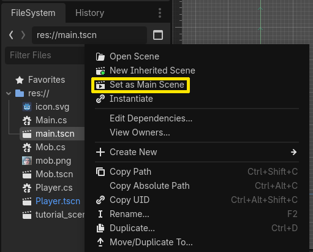

Rajoutez `NewGame();` dans la fonction `_Ready()` et lancez le jeu dans l'éditeur.

# Le HUD

Maintenant que vous maîtrisez les bases de Godot, regardons comment afficher des informations sur le HUD.

Le node `CanvasLayer` permet d'afficher des éléments d'interface utilisateur par dessus le reste du jeu, ajoutez-en un à votre scène et renommez-le en `HUD`.

Chaque élément d'UI va hériter de ce node. Le node basique pour ces éléments est `Control`. Nous allons utiliser principalement deux types de node `Control` :
- `Label` pour afficher du texte
- `Button` pour afficher et utiliser des boutons

Vous pouvez bien-sûr rajouter des éléments d'UI en plus comme des images.

Commencez par ajouter un node `Label` renommé en `Score` et positionnez-le sur votre canvas.

Vous pouvez modifier tout les paramètres que vous souhaitez dans les propriétés du `Label`  et de `Control` comme la taille de la police et la position du texte.

Ajoutez un bouton et placez-le au centre de votre canvas, comme pour le label, éditez les paramètres dont vous avez besoin pour que le bouton soit bien visible.

Ajoutez enfin un script à votre `HUD`

## En Autonomie :

**Au lieu de faire démarrer le jeu automatiquement, faites en sorte que le jeu démarre lorsqu'on appuie sur le bouton**
(Pensez à cacher le bouton une fois le jeu démarré)

**Trouvez un moyen de connecter votre score en jeu à un label et de l'afficher sur le HUD :)**

## Auteur(s)
| [<br><sub>Guillaume CBV</sub>](https://github.com/EdenComp)
| :---:

