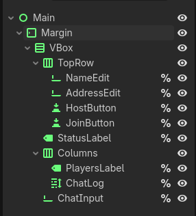
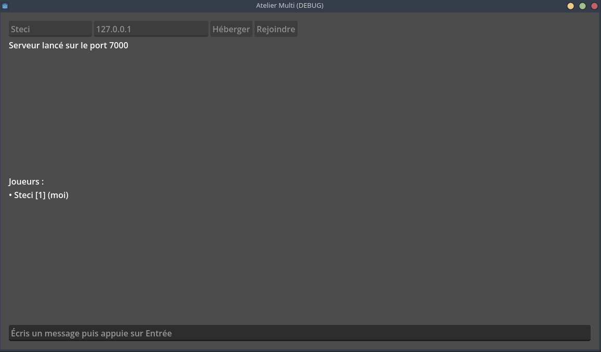
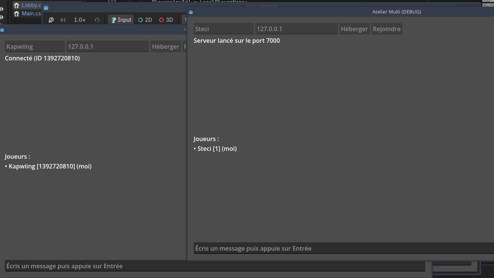
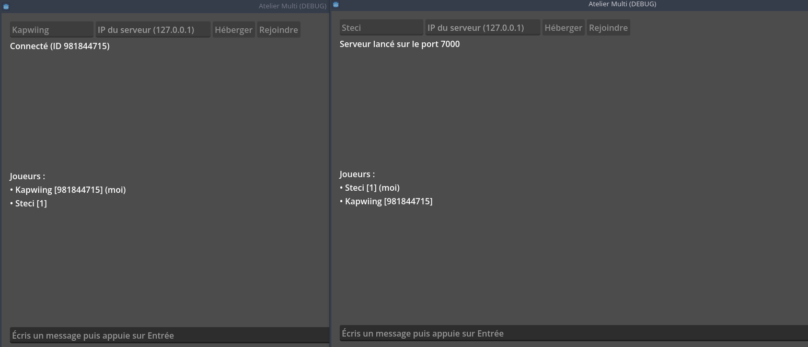
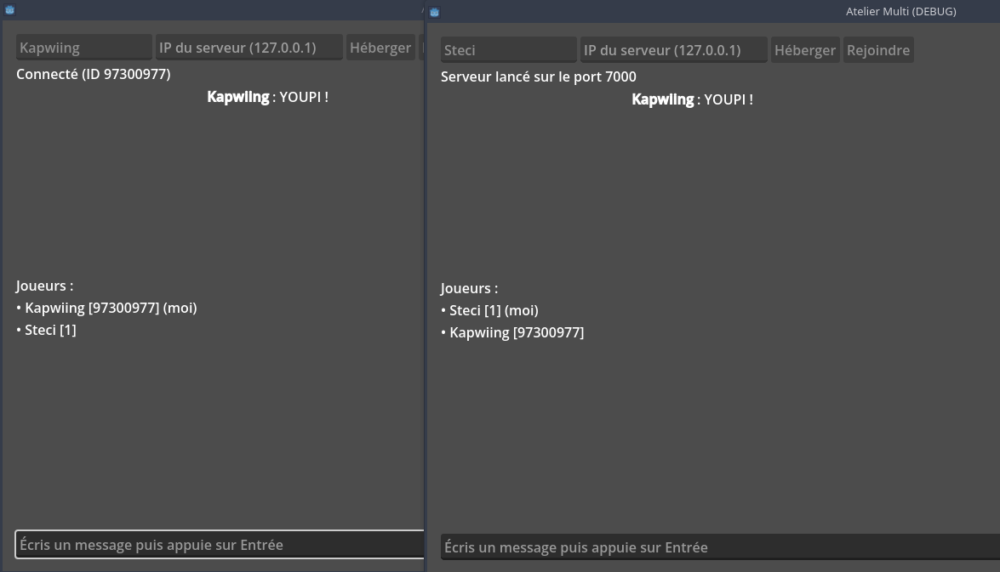

# Godot Multijoueur (1/2) : Se connecter et se parler - V0.1

Ce workshop a été conçu pour être réalisé sous **Linux**. Il est basé sur la page [High-level multiplayer](https://docs.godotengine.org/en/stable/tutorials/networking/high_level_multiplayer.html) de la documentation officielle de Godot, adaptée pour EPITECH Paris.

Il faut avoir la version SDK de Godot pour faire ce workshop !!

C'est la **première partie** d'un workshop en deux temps.

Ce workshop suppose que vous connaissez déjà les bases de Godot (Scènes, Nodes, Signaux, scripts C#). Si ce n'est pas le cas, faites d'abord le workshop **Godot Introduction** Puis **Godot Intermediate** pour voir la 3D.

# Introduction

Dans ce workshop, nous allons découvrir les bases du multijoueur dans Godot :

* Les **Peers** et leurs identifiants
* La connexion **client / serveur** avec ENet
* Les **signaux** de connexion et de déconnexion
* Les **RPC** (Remote Procedure Calls) en C# <sub>Toujours pas de GDScript, désolée :)</sub>

La documentation officielle est votre meilleure amie pour ce workshop. Gardez-la ouverte dans un onglet. <sub>ça vous aidera grandement....</sub>

N'oubliez pas la **documentation de l'éditeur**, avec le bouton **`Search Help`** dans la vue **Script**. Cherchez par exemple `ENetMultiplayerPeer` ou `MultiplayerAPI`.

Notre objectif sera de créer un **salon de discussion en réseau** : un joueur héberge une partie, les autres la rejoignent, tout le monde voit la liste des joueurs connectés et peut envoyer des messages. Pas de logique de jeu, juste un multi qui marche !

# Les notions à connaître

## Serveur, clients et Peers

Chaque instance du jeu connectée au réseau est appelée un **peer**. L'un d'eux joue le rôle de **serveur** (l'hôte de la partie), les autres sont des **clients**.

Chaque peer possède un **identifiant unique** (un ID). Les clients ne se connectent qu'au serveur : quand un client parle à un autre client, Godot fait passer le message par le serveur, sans que vous ayez à le coder.

> Cherchez dans la documentation : **quel est toujours l'ID du serveur ?** Et celui des clients ?

## UDP et ENet

TCP garantit que tous les paquets arrivent, dans l'ordre, mais il est lent. UDP est rapide, mais des paquets peuvent se perdre ou arriver dans le désordre.

Godot utilise **ENet**, une bibliothèque qui ajoute par-dessus UDP la fiabilité et l'ordre **uniquement quand on les demande**. Vous n'écrirez jamais de paquet à la main : l'API haut niveau de Godot s'en charge.

## Adresse IP et port

Pour rejoindre un serveur, un client a besoin de son **adresse IP** et du **port** sur lequel il écoute.

| Pour jouer… | Adresse à utiliser |
| --- | --- |
| Sur la même machine | `127.0.0.1` (localhost) |
| Sur le même réseau local | L'IP locale de l'hôte (souvent `192.168.x.x`, voir `ip addr`) |
| Sur Internet | L'IP publique de l'hôte, avec le port redirigé **en UDP** sur la box (hors sujet aujourd'hui) |

Pendant tout ce workshop, on utilisera le port **7000**, comme dans la documentation.

## Les RPC

Un **RPC** (Remote Procedure Call) est une fonction que l'on peut déclencher **sur une autre machine**. C'est l'outil principal de ce workshop.

En C#, on déclare un RPC avec l'attribut `[Rpc]`, puis on l'appelle avec `Rpc(...)` ou `RpcId(...)`. Voici l'exemple de la documentation :

```cs
public override void _Ready()
{
    if (Multiplayer.IsServer())
    {
        Rpc(MethodName.PrintOncePerClient);
    }
}

[Rpc]
private void PrintOncePerClient()
{
    GD.Print("I will be printed to the console once per each connected client.");
}
```

L'attribut `[Rpc]` accepte plusieurs options. Elles sont **très importantes**, vous allez devoir choisir les bonnes à chaque étape :

| Option | Valeurs possibles (défaut en gras) | Ce que ça contrôle |
| --- | --- | --- |
| Mode | **`MultiplayerApi.RpcMode.Authority`**, `MultiplayerApi.RpcMode.AnyPeer` | **Qui** a le droit d'appeler la fonction |
| `CallLocal` | **`false`**, `true` | Si la fonction s'exécute aussi chez **celui qui l'appelle** |
| `TransferMode` | **`Reliable`**, `Unreliable`, `UnreliableOrdered` | La garantie de livraison |
| `TransferChannel` | **`0`** | Le canal utilisé (on en reparlera dans la partie 2) |

D'après la documentation, un simple `[Rpc]` est équivalent à :

```cs
[Rpc(MultiplayerApi.RpcMode.Authority, CallLocal = false, TransferMode = MultiplayerPeer.TransferModeEnum.Reliable, TransferChannel = 0)]
```

> Lisez la section **Remote procedure calls** de la documentation. **Quelle est la différence entre `Rpc()` et `RpcId()` ?** Et à quoi sert `Multiplayer.GetRemoteSenderId()` ?

Deux règles d'or à garder en tête pendant tout le workshop :

* Un RPC n'arrive que si le node a **le même chemin** (`NodePath`) chez celui qui l'envoie et chez celui qui le reçoit.
* Un RPC ne transporte que des **types simples** : `int`, `long`, `string`, `Vector2`, tableaux et dictionnaires Godot… Pas vos propres objets C#.

---

# Mise en place du projet

Créez un nouveau projet Godot .NET nommé comme vous voulez.

## Le Lobby

Tout notre code réseau va vivre dans un seul script, `Lobby.cs`, que nous allons rendre accessible partout grâce à un **Autoload**.

Dans le dock **FileSystem**, faites un clic droit → **New Script**, choisissez le langage **C#**, le nom `Lobby.cs` et la classe de base `Node`.

Remplacez son contenu par le squelette suivant :

```cs
using Godot;
using System.Collections.Generic;

public partial class Lobby : Node
{
    public static Lobby Instance { get; private set; }

    [Signal] public delegate void StatusChangedEventHandler(string status);
    [Signal] public delegate void PlayersChangedEventHandler();
    [Signal] public delegate void ChatMessageReceivedEventHandler(string author, string message);

    public const int Port = 7000;
    public const string DefaultServerIP = "127.0.0.1"; // localhost = "ma propre machine"
    public const int MaxConnections = 8;

    // Tous les joueurs connus : ID du peer -> pseudo
    public Dictionary<long, string> Players { get; } = new();
    public string LocalPlayerName { get; set; } = "Joueur";

    public override void _Ready()
    {
        Instance = this;
    }

    public Error CreateGame()
    {
        return Error.Ok;
    }

    public Error JoinGame(string address)
    {
        return Error.Ok;
    }

    public void SendChat(string message)
    {
    }
}
```

Prenez quelques minutes pour lire ce squelette :

* les trois **signaux** serviront à prévenir l'interface quand quelque chose change ;
* `Players` contiendra tous les joueurs connectés, avec leur ID comme clé ;
* `Instance` permettra d'accéder au Lobby depuis n'importe quel script avec `Lobby.Instance`.

> **Pourquoi la classe doit-elle être `partial` ?** <small>(Indice : d'où viennent `MethodName` et `SignalName` ?)</small>

Ouvrez maintenant **Project → Project Settings → Globals → Autoload**, sélectionnez `res://Lobby.cs`, laissez le nom `Lobby` et cliquez sur **Add**.

> Un Autoload est ajouté automatiquement à la racine de l'arbre, au chemin `/root/Lobby`, **sur toutes les instances du jeu**. Relisez la première règle d'or des RPC : pourquoi est-ce pratique pour nous ?

## L'interface

L'interface n'est pas le sujet de ce workshop : vous allez la monter rapidement dans l'éditeur, et le script qui la relie au `Lobby` vous est donné.

### La scène

Prenez le fichier `ressources/main.tscn` et ajoutez le à votre projet.
Normalement, quand vous reloader votre nouveau projet, ça devrait afficher ceci :



### Le script

Attachez au node `Main` un script C# `Main.cs` et copiez-y le code suivant. Vous n'avez pas besoin de le modifier.

```cs
using Godot;
using System.Linq;

public partial class Main : Control
{
    private LineEdit _nameEdit;
    private LineEdit _addressEdit;
    private Button _hostButton;
    private Button _joinButton;
    private Label _statusLabel;
    private Label _playersLabel;
    private RichTextLabel _chatLog;
    private LineEdit _chatInput;

    public override void _Ready()
    {
        // "%" = Unique Name : le node est trouvé où qu'il soit dans la scène
        _nameEdit = GetNode<LineEdit>("%NameEdit");
        _addressEdit = GetNode<LineEdit>("%AddressEdit");
        _hostButton = GetNode<Button>("%HostButton");
        _joinButton = GetNode<Button>("%JoinButton");
        _statusLabel = GetNode<Label>("%StatusLabel");
        _playersLabel = GetNode<Label>("%PlayersLabel");
        _chatLog = GetNode<RichTextLabel>("%ChatLog");
        _chatInput = GetNode<LineEdit>("%ChatInput");

        _hostButton.Pressed += OnHostPressed;
        _joinButton.Pressed += OnJoinPressed;
        _chatInput.TextSubmitted += OnChatSubmitted;

        Lobby.Instance.StatusChanged += OnStatusChanged;
        Lobby.Instance.PlayersChanged += RefreshPlayers;
        Lobby.Instance.ChatMessageReceived += OnChatMessageReceived;
    }

    public override void _ExitTree()
    {
        Lobby.Instance.StatusChanged -= OnStatusChanged;
        Lobby.Instance.PlayersChanged -= RefreshPlayers;
        Lobby.Instance.ChatMessageReceived -= OnChatMessageReceived;
    }

    private void OnHostPressed()
    {
        Lobby.Instance.LocalPlayerName = GetPlayerName();
        if (Lobby.Instance.CreateGame() == Error.Ok)
        {
            SetConnectedUi(true);
        }
    }

    private void OnJoinPressed()
    {
        Lobby.Instance.LocalPlayerName = GetPlayerName();
        if (Lobby.Instance.JoinGame(_addressEdit.Text) == Error.Ok)
        {
            SetConnectedUi(true);
        }
    }

    private void OnChatSubmitted(string text)
    {
        if (Lobby.Instance.Players.Count == 0)
        {
            return; // pas encore connecté
        }

        Lobby.Instance.SendChat(text);
        _chatInput.Clear();
    }

    private void OnStatusChanged(string status)
    {
        _statusLabel.Text = status;
    }

    private void RefreshPlayers()
    {
        long myId = Multiplayer.GetUniqueId();
        var lines = Lobby.Instance.Players.Select(p =>
            p.Key == myId ? $"• {p.Value} [{p.Key}] (moi)" : $"• {p.Value} [{p.Key}]");
        _playersLabel.Text = "Joueurs :\n" + string.Join("\n", lines);

        // Liste vide = plus connecté (échec ou serveur parti) : on réactive les boutons
        SetConnectedUi(Lobby.Instance.Players.Count > 0);
    }

    private void OnChatMessageReceived(string author, string message)
    {
        _chatLog.PushBold();
        _chatLog.AddText(author);
        _chatLog.Pop();
        _chatLog.AddText($" : {message}\n");
    }

    private string GetPlayerName()
    {
        string name = _nameEdit.Text.Trim();
        return name.Length > 0 ? name : "Joueur";
    }

    private void SetConnectedUi(bool connected)
    {
        _hostButton.Disabled = connected;
        _joinButton.Disabled = connected;
        _nameEdit.Editable = !connected;
        _addressEdit.Editable = !connected;
    }
}
```

> Si le jeu plante au lancement avec une erreur `Node not found: "%..."`, vérifiez le **nom exact** du node et qu'il est bien en **Unique Name**.

Comme toujours en C#, pensez à **compiler le projet**, puis définissez `main.tscn` comme **scène principale** (clic droit dans le FileSystem → **Set as Main Scene**).

## Lancer plusieurs instances

Pour tester du multijoueur, il faut plusieurs fenêtres du jeu en même temps.

Ouvrez **Debug → Customize Run Instances...**, cochez **Enable Multiple Instances** et choisissez **3** instances.

Lancez le jeu : trois fenêtres s'ouvrent. Placez-les côte à côte. Pour l'instant, les boutons ne font rien.

---

# Héberger et rejoindre une partie

Pour passer en ligne, Godot a besoin d'un objet **`MultiplayerPeer`** : c'est lui qui gère la connexion réseau. Godot en fournit une implémentation basée sur ENet.

Le principe est toujours le même :

1. créer un peer ;
2. l'initialiser **en tant que serveur** ou **en tant que client** ;
3. le donner à l'API multijoueur du node.

> Lisez la section **Initializing the network** de la documentation : tout ce dont vous avez besoin y est.

## Créer le serveur

Complétez la fonction `CreateGame()` :

```cs
public Error CreateGame()
{
    // 1 - Créer un peer ENet
    // TIP : quelle classe implémente MultiplayerPeer avec ENet ?
    // var peer =

    // 2 - L'initialiser en tant que serveur, sur le port Port, avec MaxConnections joueurs au maximum
    // TIP : cette méthode renvoie une Error. Si ce n'est pas Error.Ok,
    //       prévenez l'interface avec le signal StatusChanged et renvoyez l'erreur.
    // Error error =

    // 3 - Brancher ce peer sur l'API multijoueur
    // TIP : chaque Node possède une propriété Multiplayer...

    // 4 - Le serveur est aussi un joueur : ajoutez-le dans Players
    // TIP : quel est l'ID du serveur ?

    // 5 - Prévenir l'interface : un message de statut, et la liste des joueurs a changé
    // TIP : man EmitSignal, SignalName

    return Error.Ok;
}
```
Une fois réussi, vous devriez pouvoir faire ceci : 



## Rejoindre le serveur

Complétez maintenant `JoinGame()` sur le même modèle. Quelques différences :

* si `address` est vide, utilisez `DefaultServerIP` ;
* cette fois, le peer est initialisé **en tant que client** ;
* le client ne connaît pas encore son ID : ne touchez pas à `Players` ici.

> `peer.???(address, Port);`

Compilez, lancez les 3 instances, cliquez sur **Héberger** dans la première fenêtre et **Rejoindre** dans les deux autres. Rien de visible ne se passe encore côté clients, c'est normal : personne n'écoute les événements réseau.

## Écouter les événements réseau

L'API multijoueur émet des **signaux** quand quelque chose se passe sur le réseau. Lisez la section **Managing connections** de la documentation.

| Signal C# | Émis quand… | Émis chez… |
| --- | --- | --- |
| `PeerConnected(long id)` | un autre peer arrive | tout le monde |
| `PeerDisconnected(long id)` | un autre peer part | tout le monde |
| `ConnectedToServer()` | la connexion au serveur a réussi | les clients |
| `ConnectionFailed()` | la connexion au serveur a échoué | les clients |
| `ServerDisconnected()` | le serveur est parti | les clients |

Dans `_Ready()`, abonnez-vous à ces 5 signaux. Ils sont tous accessibles depuis `Multiplayer` :

> `Multiplayer.??? += OnPeerConnected;`

Créez ensuite les 5 méthodes correspondantes :

* `OnPeerConnected(long id)` et `OnPeerDisconnected(long id)` : pour l'instant, affichez simplement dans la sortie votre propre ID et l'ID reçu avec `GD.Print()`. On les remplira à l'étape suivante.
* `OnConnectedToServer()` : le client connaît enfin son ID. Ajoutez-vous dans `Players`, puis prévenez l'interface en affichant votre ID dans le statut.
* `OnConnectionFailed()` et `OnServerDisconnected()` : coupez le réseau, videz `Players` et prévenez l'interface.

> `Multiplayer.GetUniqueId()`

Pour **couper le réseau**, la documentation C# remplace le peer par `null`. Préférez-lui un `new OfflineMultiplayerPeer()`.

> **Pourquoi ?** Essayez d'appeler `Multiplayer.GetUniqueId()` juste après avoir mis le peer à `null`, et regardez la sortie.

Une fois réussi, normalement vous devriez avoir ça : 



C'est normal si ils ne voyent pas les pseudos des un et des autres, c'est la prochaine étape ! :D

## Vérifiez que tout fonctionne

* La fenêtre 1 (**Héberger**) affiche son ID dans le statut.
* Les fenêtres 2 et 3 (**Rejoindre**, IP vide) affichent un statut connecté avec un **grand nombre** comme ID.
* Fermez la fenêtre 1 : les deux autres doivent afficher que le serveur est parti.
* Lancez une fenêtre et cliquez sur **Rejoindre** sans hôte : au bout de quelques secondes, la connexion doit échouer.

> Avec 3 fenêtres, lisez attentivement la sortie. **Qui reçoit `PeerConnected`, et avec quels IDs ?** Que reçoit le dernier arrivé ?

---

# Qui est là ? Échanger les pseudos

Chaque peer connaît maintenant les **IDs** des autres… mais pas leurs **pseudos**. C'est l'heure de votre premier RPC !

> Réfléchissez avant de coder : `PeerConnected` est émis chez vous chaque fois qu'un autre peer apparaît. **Que pourriez-vous lui envoyer à ce moment-là ?**

Utilisez la base suivante :

```cs
private void OnPeerConnected(long id)
{
    // TIP : envoyez votre pseudo à CE peer, et seulement à lui
    // TIP : man RpcId, MethodName
}

// TIP : quel mode choisir ? Qui va appeler cette fonction ?
// [Rpc(???)]
private void RegisterPlayer(string playerName)
{
    // 1 - Retrouver l'ID de celui qui vous a appelé
    // TIP : relisez la section "Remote procedure calls" de la documentation
    // long senderId =

    // 2 - Enregistrer le joueur dans Players

    // 3 - Prévenir l'interface
}

private void OnPeerDisconnected(long id)
{
    // TIP : un joueur est parti, l'interface doit le savoir
}
```

> **Testez avec le mode par défaut (`Authority`). Que se passe-t-il ?** Lisez la sortie, puis corrigez.

> Faut-il `CallLocal = true` sur `RegisterPlayer` ? Pourquoi ?

## Vérifiez que tout fonctionne

* Les 3 fenêtres affichent la liste des 3 joueurs, avec leurs pseudos, leurs IDs, et **(moi)** à côté du vôtre.
* Fermez une fenêtre cliente : son joueur disparaît de la liste chez les autres.

Ça devrait ressembler à ça ! 



---

# Le chat

## Première version

Commençons simplement : chaque joueur envoie son message **directement à tout le monde**.

```cs
public void SendChat(string message)
{
    // TIP : appelez ReceiveChat chez TOUS les autres peers
}

// TIP : qui appelle cette fonction ? Et est-ce que JE dois voir mon propre message ?
// [Rpc(???)]
private void ReceiveChat(string message)
{
    // 1 - Retrouver l'ID de l'auteur du message

    // 2 - Retrouver son pseudo dans Players
    // TIP : que faire si l'ID n'est pas dans le dictionnaire ? man GetValueOrDefault

    // 3 - Prévenir l'interface avec le signal ChatMessageReceived
}
```

> Quand une fonction est exécutée localement grâce à `CallLocal`, **que renvoie `Multiplayer.GetRemoteSenderId()` ?**

Testez : les messages doivent s'afficher dans les trois fenêtres, avec le bon pseudo.

Maintenant, essayez d'envoyer :

* un message vide ;
* un message de plusieurs milliers de caractères.

> **Qui vérifie ce qu'un joueur envoie ?**



## En Autonomie : le serveur arbitre

La documentation est claire : **il ne faut jamais faire confiance à ce qu'envoie un client**. Le serveur doit rester la **source de vérité**.

Réécrivez le chat pour que chaque message suive ce trajet :

1. le client envoie son message **au serveur uniquement** ;
2. le serveur **vérifie** le message ;
3. si le message est valide, le serveur le **diffuse à tout le monde**.

Vous aurez besoin de **deux RPC** :

* `SubmitChat(string message)` : le client l'appelle sur le serveur ;
* `ReceiveChat(long authorId, string message)` : le serveur l'appelle chez tout le monde.

Votre version doit respecter ces règles :

* un message vide, ou de plus de **200** caractères, est refusé ;
* c'est le **serveur** qui détermine l'auteur du message, pas le client ;
* **seul le serveur** peut appeler `ReceiveChat` ;
* l'hôte doit pouvoir chatter, lui aussi.

> Quel mode pour `SubmitChat` ? Et pour `ReceiveChat` ?

> Que se passe-t-il si un client appelle `SubmitChat` chez un autre client ? Comment s'en protéger ?

> `man string.Trim`

> **Pourquoi le serveur lit-il lui-même l'ID de l'auteur au lieu de le recevoir en paramètre ?**

Testez à nouveau le message vide et le message géant : ils ne doivent plus apparaître nulle part.

> Regardez comment `Main.cs` affiche les messages avec `AddText()`. Pourquoi n'utilise-t-on pas plutôt du BBCode avec `AppendText()` ?

---

# Ça ne marche pas ?

Avant d'appeler un encadrant, vérifiez ces points :

* Avez-vous **recompilé**, puis fermé et relancé **toutes** les fenêtres ? Des instances qui tournent avec des versions différentes de votre code provoquent des erreurs RPC très bizarres.
* Le node qui envoie le RPC et celui qui le reçoit ont-ils **le même chemin** ?
* Avez-vous bien choisi le **mode** et l'option **`CallLocal`** de chaque RPC ? Relisez le tableau des options.
* Passez-vous uniquement des **types simples** en paramètres de vos RPC ?
* « Impossible de créer le serveur » : n'avez-vous pas cliqué deux fois sur **Héberger**, dans deux fenêtres différentes ?
* Lisez la **sortie** de Godot : les erreurs réseau y sont souvent très explicites.

---

# Pour aller plus loin

Vous avez fini en avance ? Voici quelques idées, toujours avec la même règle : **le client demande, le serveur vérifie et décide**.

* **Messages système** : affichez « Alice a rejoint le salon » et « Alice a quitté le salon ».
* **Anti-spam** : le serveur refuse plus d'un message par seconde et par joueur.
> `Time.GetTicksMsec()`
* **Messages privés** : `/mp Bob salut` n'envoie le message qu'à Bob (et à vous).
* **Expulsion** : `/kick Bob`, réservé à l'hôte.
> `man MultiplayerPeer.DisconnectPeer`
* **Jouer en réseau local** : hébergez sur votre machine et faites rejoindre votre voisin avec votre IP locale.

---

## Auteur(s)
| [<br><sub>Léa Guillemard</sub>](https://github.com/Steci)
| :---:
